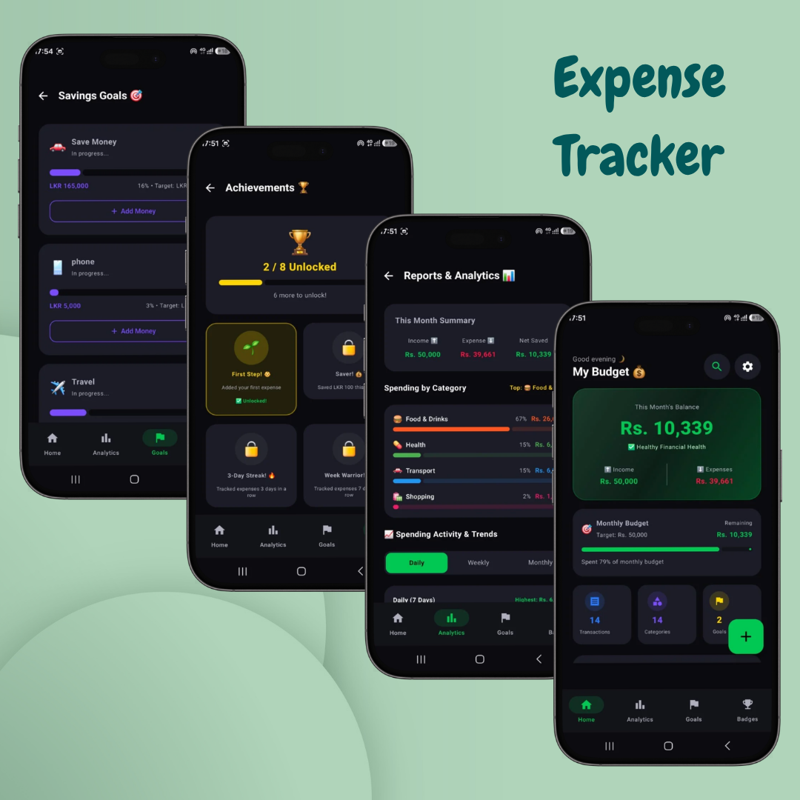

# 💰 Smart Expense Tracker & Budget Manager

<p align="center">
  
</p>

<p align="center">
  <b>A modern, privacy-focused Android app for managing personal expenses, income, budgets, and financial insights.</b>
</p>

<p align="center">
  
  
  
  
</p>

<p align="center">
  
  
  
</p>

---

## 📱 About the Project

**Smart Expense Tracker & Budget Manager** is a modern Android application designed to make personal finance management simple, secure, and user-friendly.

The application allows users to:

- 💰 Track income and expenses
- 📊 Monitor monthly budgets
- 🏦 Manage different payment accounts
- 🧾 Attach receipt and bill images
- 🔍 Search and filter transactions
- 📈 Analyze spending patterns
- 📄 Generate PDF financial statements
- 📤 Export financial data
- 💱 Use multiple currencies
- 🔐 Protect the application with a PIN
- 🌙 Switch between Dark and Light themes

The app follows an **offline-first and privacy-focused approach**, keeping financial data locally on the user's device without requiring an external backend server.

---

# ✨ Key Features

## 💰 1. Expense & Income Management

Users can easily manage their financial transactions.

### Supported operations

- ➕ Add transactions
- ✏️ Edit transactions
- 🗑️ Delete transactions
- 👁️ View transaction details
- 💵 Track income
- 💸 Track expenses
- 📝 Add notes
- 📅 Select transaction dates
- 😊 Track spending mood

### Payment Accounts

Transactions can be associated with different accounts:

- 💵 Cash
- 🏦 Bank Account
- 💳 Credit Card
- 🐷 Savings

---

## 🧾 2. Receipt & Bill Attachments

Users can attach receipt or bill images to transactions.

Images can be selected from:

- 📷 Camera
- 🖼️ Gallery

Receipt images are stored inside the application's private internal storage.

This helps keep financial documents private and inaccessible to other applications.

---

## 🎯 3. Monthly Budget Tracker

Set a monthly spending target and monitor progress.

The dashboard provides:

- 💰 Monthly budget
- 💸 Total spending
- 💵 Remaining budget
- 📊 Spending percentage
- 🚨 Budget warning
- ⚠️ Over-budget notification

A smart animated progress indicator helps users understand their current spending level at a glance.

---

## 🎨 4. Custom Categories

Users can create their own transaction categories.

Each custom category can contain:

- 🏷️ Category name
- 😀 Emoji
- 🎨 Custom color

The application provides **15+ vibrant colors** for category customization.

Example categories:

- 🍔 Food
- 🚗 Transport
- 🛍️ Shopping
- 🏠 Rent
- 🎮 Entertainment
- 💊 Health
- 📚 Education
- ✈️ Travel

---

## 🔍 5. Powerful Search & Filters

Find transactions quickly using the built-in search system.

### Search by

- Transaction name
- Note
- Category

### Filter by Type

- All
- Expenses
- Income

### Filter by Time

- Today
- This Week
- This Month
- All Time

### Filter by Payment Method

- Cash
- Bank
- Card
- Savings

The filtered results also display:

- Total Income
- Total Expenses
- Number of Transactions

---

# 📊 6. Financial Analytics

The Analytics section provides visual insights into spending habits.

### Category Spending Breakdown

Users can see:

- Spending by category
- Percentage of total spending
- Highest spending categories
- Overall expense distribution

### Activity & Trends

The application supports different time periods:

| Period | Description |
|---|---|
| 📅 Daily | Last 7 days |
| 📆 Weekly | Last 4 weeks |
| 🗓️ Monthly | Last 6 months |

Each chart displays the exact amount associated with the corresponding bar.

---

# 🧠 7. Smart Financial Insights

The application generates simple financial insights based on transaction data.

Example:

> "You saved 35% this month."

Other insights can highlight:

- Spending increases
- Spending decreases
- Savings percentage
- Highest spending category
- Budget status

---

# 📄 8. PDF Financial Statements

Users can generate professional PDF reports for their financial activity.

### Supported date ranges

- Current month
- Previous months
- Custom date range

The generated report contains relevant transaction and financial information in an A4-style layout.

### Sharing

PDF statements can be shared through:

- WhatsApp
- Gmail
- Google Drive
- Other supported Android applications

The application uses Android's **FileProvider** and secure `content://` URIs when sharing files.

---

# 📊 9. CSV / Spreadsheet Export

Financial data can also be exported as a spreadsheet-compatible CSV file.

This allows users to:

- Keep an external backup
- Analyze data using spreadsheet applications
- Maintain financial records
- Transfer data for further analysis

---

# 💱 10. Multi-Currency Support

The application supports multiple currencies.

Currently supported currencies include:

- 🇱🇰 LKR – Sri Lankan Rupee
- 🇺🇸 USD – US Dollar
- 🇪🇺 EUR – Euro
- 🇬🇧 GBP – British Pound
- 🇮🇳 INR – Indian Rupee
- 🇦🇪 AED – UAE Dirham

---

# 🌙 11. Dark & Light Mode

The application supports both:

- ☀️ Light Mode
- 🌙 Dark Mode

The interface is built using **Material 3** design principles.

---

# 🔐 12. Security & Privacy

Privacy is one of the main design goals of this project.

## 🔒 PIN Lock

The application provides a **4-digit PIN lock**.

The lock can appear when:

- Launching the application
- Returning to the application after it goes into the background

## 🔑 PIN Management

Users can:

- Set a PIN
- Change the PIN
- Disable the PIN

The current PIN must be verified before changing or disabling the security lock.

A confirmation step is also included when creating a new PIN.

---

# 🛡️ Privacy-Focused Architecture

The application follows an **offline-first architecture**.

### No external backend required

Financial information is stored locally on the device.

The application does not require a remote database or server to manage basic financial data.

### Local data

Stored locally includes:

- Transactions
- Categories
- Budgets
- Savings goals
- Wallet/account information
- Currency settings
- PIN settings

### Receipt images

Receipt images are stored in the application's private internal storage.

---

# 🏗️ Technology Stack

| Technology | Purpose |
|---|---|
| **Kotlin 2.2+** | Programming Language |
| **Jetpack Compose** | UI Development |
| **Material 3** | Modern Android UI |
| **MVVM** | Application Architecture |
| **Kotlin Coroutines** | Asynchronous Operations |
| **StateFlow** | Reactive State Management |
| **DataStore** | Local Preferences & Persistence |
| **Gson** | JSON Serialization |
| **Android PdfDocument** | PDF Generation |
| **FileProvider** | Secure File Sharing |
| **Gradle Kotlin DSL** | Build System |
| **Android Studio** | Development Environment |

---

# 🏛️ Architecture

The application follows the **MVVM (Model-View-ViewModel)** architecture with unidirectional data flow.

```text
┌──────────────────────────┐
│        UI Layer          │
│     Jetpack Compose      │
│                          │
│ Home / Add / Analytics   │
│ Search / Settings        │
└────────────┬─────────────┘
             │
             ▼
┌──────────────────────────┐
│      ViewModel Layer     │
│                          │
│   ExpenseViewModel       │
│                          │
│ Business Logic           │
│ Calculations             │
│ State Management         │
└────────────┬─────────────┘
             │
             ▼
┌──────────────────────────┐
│       Data Layer         │
│                          │
│      DataStore           │
│        + Gson             │
│                          │
│ Transactions / Budgets   │
│ Categories / Settings   │
└──────────────────────────┘
```

---

# 📂 Project Structure

```text
app/
└── src/
    └── main/
        ├── java/
        │   └── .../
        │       ├── MainActivity.kt
        │       │
        │       ├── ExpenseViewModel.kt
        │       │
        │       ├── Expense.kt
        │       │
        │       ├── HomeScreen.kt
        │       │
        │       ├── AddExpenseScreen.kt
        │       │
        │       ├── AnalyticsScreen.kt
        │       │
        │       ├── TransactionsSearchScreen.kt
        │       │
        │       ├── ManageCategoriesScreen.kt
        │       │
        │       ├── SettingsScreen.kt
        │       │
        │       ├── PdfReportGenerator.kt
        │       │
        │       ├── ReportShareHelper.kt
        │       │
        │       └── ImageHelper.kt
        │
        └── res/
            ├── drawable/
            ├── mipmap/
            └── values/
```

---

# 🗂️ Main Components

### `MainActivity.kt`

Main application entry point.

Responsibilities include:

- Application initialization
- PIN lock verification
- Lifecycle handling
- Compose navigation

### `ExpenseViewModel.kt`

Responsible for:

- Business logic
- Transaction management
- Budget calculations
- Balance calculations
- Financial insights
- DataStore interaction

### `Expense.kt`

Contains application data models such as:

- Expense
- CategoryItem
- WalletAccount
- SavingsGoal
- Achievements

### `HomeScreen.kt`

Main dashboard containing:

- Balance
- Budget progress
- Spending summary
- Recent transactions

### `AddExpenseScreen.kt`

Used for:

- Adding expenses
- Adding income
- Editing transactions
- Selecting categories
- Selecting payment accounts
- Attaching receipts

### `AnalyticsScreen.kt`

Provides:

- Category breakdown
- Spending charts
- Activity trends
- Financial insights

### `TransactionsSearchScreen.kt`

Provides:

- Search
- Filtering
- Transaction summaries

### `ManageCategoriesScreen.kt`

Used to:

- Create custom categories
- Select emoji
- Select colors
- Delete categories

### `SettingsScreen.kt`

Central location for:

- Budget settings
- PIN security
- Currency
- Theme
- Export tools

### `PdfReportGenerator.kt`

Responsible for generating PDF financial reports using Android's `PdfDocument`.

### `ReportShareHelper.kt`

Handles secure sharing of generated files using Android `FileProvider`.

### `ImageHelper.kt`

Handles:

- Receipt image storage
- Image loading
- Image decoding

---

# 📱 Android Compatibility

| Configuration | Version |
|---|---|
| **Minimum SDK** | Android 7.0 (API 24) |
| **Target SDK** | API 37 |
| **UI** | Jetpack Compose |
| **Architecture** | MVVM |
| **Storage** | Local / Offline-first |

---

# ⚡ Offline-First Design

One of the main goals of this application is to provide a useful financial management experience without requiring an internet connection.

```text
User
 │
 ▼
Android Application
 │
 ├── Transactions
 ├── Categories
 ├── Budgets
 ├── Settings
 └── Receipt Images
 │
 ▼
Local Device Storage
```

No cloud backend is required for normal application usage.

This provides:

- 🔒 Better privacy
- ⚡ Fast local access
- 📡 Offline availability
- 💾 Local data ownership

---

# 🔐 Data Storage

The application uses:

### Preferences DataStore

Used for storing application data and settings.

### Gson

Used to serialize and deserialize complex Kotlin objects and lists into JSON.

Example:

```text
Kotlin Data Object
       ↓
      Gson
       ↓
     JSON
       ↓
   DataStore
```

---

# 🧩 Design Principles

The project follows several modern software development principles:

- ✅ MVVM Architecture
- ✅ Single Source of Truth
- ✅ Unidirectional Data Flow
- ✅ Separation of Concerns
- ✅ Reusable Compose Components
- ✅ Offline-first Design
- ✅ Privacy-focused Storage
- ✅ Clean and Maintainable Code

---

# 🚀 Getting Started

## 1. Clone the Repository

```bash
git clone https://github.com/YOUR_USERNAME/YOUR_REPOSITORY.git
```

## 2. Open the Project

Open the project using **Android Studio**.

Recommended:

- Android Studio
- JDK compatible with the project
- Android SDK
- Gradle

## 3. Sync Gradle

Allow Android Studio to download and synchronize the required dependencies.

## 4. Run the Application

Connect an Android device or start an Android Emulator.

Then run:

```text
Run ▶
```

---

# 🛠️ Future Improvements

Potential future improvements include:

- ☁️ Optional encrypted cloud backup
- 🔄 Device-to-device data migration
- 🤖 More advanced AI-powered financial insights
- 🔔 Smart bill reminders
- 💳 Recurring transaction support
- 📊 More advanced financial dashboards
- 🧾 Automatic receipt OCR
- 📈 Savings prediction
- 🔐 Biometric authentication
- 📱 Tablet optimization
- 🌍 Additional currencies
- 🔄 Automatic backup and restore

---

  ## 🔗 Links

**🎥 Project Demo Video:**
👉 [Fitness App Video](https://drive.google.com/file/d/1aFUKe--HwChxMh5laVV4v55k4x1C_OsG/view?usp=sharing)

---

